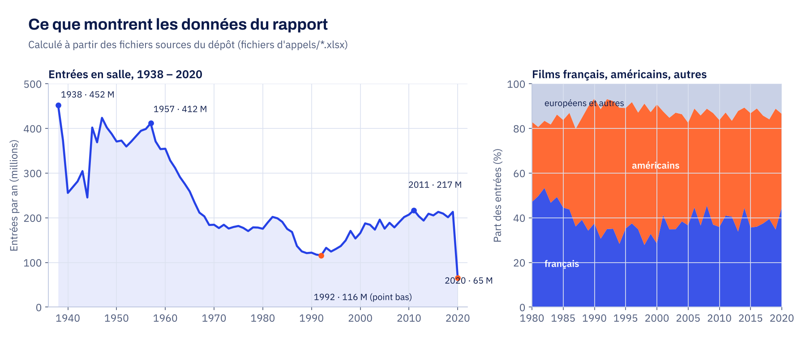

  
  
  
  
  

# Fréquentation des cinémas en France, 1938–2020 · Power BI

**Franck Nankeng** · Projet de ma certification Power BI · [LinkedIn](https://www.linkedin.com/in/franck-nankeng-51b43b297/)

Rapport Power BI qui retrace l'évolution de la fréquentation des salles françaises : entrées, recettes et séances
sur plus de 80 ans, part des films français, américains et européens, et répartition des entrées selon le jour de la semaine.

Aperçu calculé à partir des fichiers sources du dépôt

## Questions traitées
- Comment les entrées, les recettes et le nombre de séances ont-ils évolué depuis 1938 ?
- Quelle part du public vont chercher les films français face aux films américains et européens ?
- Quels jours de la semaine concentrent la fréquentation, et cette répartition a-t-elle changé ?
- Quelle est la saisonnalité des séances au fil des mois ?

## Ce que j'ai réalisé
- **Power Query** : suppression des lignes et colonnes vides, dépivotage des tableaux larges, conversion des valeurs en
  pourcentages, remplacement des « - » par des valeurs nulles pour typer les colonnes, création d'une date à partir de l'année et du mois,
  nettoyage des libellés (« films français » devient « français », espaces superflus supprimés).
- **Modèle de données** : toutes les tables reliées à une table centrale, filtrage croisé configuré dans les deux sens.
- **Sécurité** : rôle « 10 dernières années » limitant l'accès aux données 2010–2020 (sécurité au niveau des lignes).
- **Rapport** : histogramme, graphique en ruban, courbes, anneau, table, segment et bouton de navigation.

## Contenu
Tout se trouve dans le dossier `ANALYSE-DES-EVOLUTIONS-DE-LA-FREQUENTATION-DES-CINEMAS-master/`.

| Fichier | Rôle |
|---|---|
| `Projet_Cinémas.pbix` | Rapport Power BI |
| `fichiers d'appels/*.xlsx` | Données sources : fréquentation globale, séances par mois, entrées par origine et par jour |
| `ennoncé Projet.docx` | Cahier des charges de l'exercice |

## Ouvrir le rapport
Installer [Power BI Desktop](https://powerbi.microsoft.com/desktop/), ouvrir `Projet_Cinémas.pbix`, puis, si besoin,
redéfinir le chemin du dossier `fichiers d'appels` dans *Transformer les données › Paramètres de la source de données*.

---
*English — Power BI report on French cinema attendance since 1938: Power Query cleaning (unpivot, null handling, date building),
a star-like data model with bidirectional filters, a row-level security role, and an interactive report.*

---

### Autres projets

| [**Groupe Orvane**](https://github.com/Nganou1/orvane-powerbi) | [**Horizon_Contrat**](https://github.com/Nganou1/horizon-contrat-excel) | [**Process mining achats**](https://github.com/Nganou1/process-mining-achats) | [**Projets IA & ML**](https://github.com/Nganou1/projets-ia) |
|---|---|---|---|
| Power BI · 143 mesures DAX · RLS | Excel expert · Power Pivot · VBA | Python · PM4Py · audit SI | Python · machine learning · deep learning |

[Tous mes dépôts](https://github.com/Nganou1?tab=repositories) · [LinkedIn](https://www.linkedin.com/in/franck-nankeng-51b43b297/)
